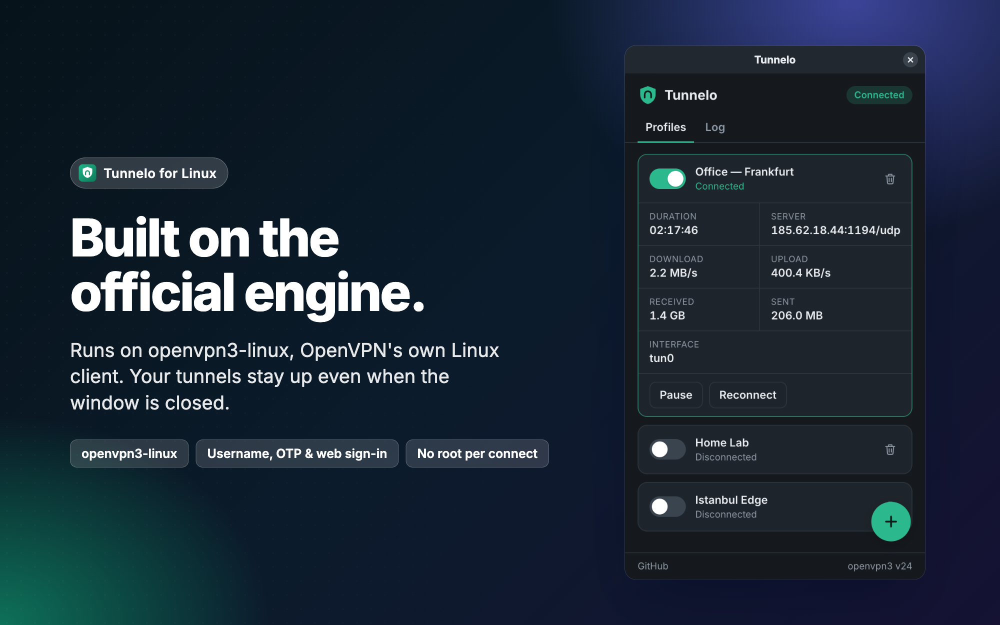

<p align="center">
  
</p>

<h1 align="center">Linux Client for OpenVPN</h1>

<p align="center">
  <strong>Flip one switch. You're private.</strong><br>
  Import your <code>.ovpn</code> profile and connect in one click.
</p>

<p align="center">
  <a href="https://github.com/aftandilmmd/openvpn-linux-client/releases/latest"><strong>Download</strong></a> · Ubuntu · Debian · Fedora · AppImage
</p>

<p align="center">
  
</p>

## Features

- **One-click connect.** Drop in an `.ovpn` file and flip the switch.
- **Sign-in built in.** Username and password, one-time codes, and web (SSO) sign-in.
- **Live status.** Connection time, server, speed and total traffic.
- **Automatic updates.** A banner appears when a new version is out; one click installs it.
- **Light and dark mode**, following your desktop.

<p align="center">
  
</p>

## Installing

Download the file for your system from the [latest release](https://github.com/aftandilmmd/openvpn-linux-client/releases/latest) and open it:

- **Ubuntu / Debian:** `.deb`
- **Fedora:** `.rpm`
- **Any distribution:** `.AppImage` (make it executable, then run it)

On first start, the app installs OpenVPN 3, the official engine it runs on, if it's missing. Click **Install OpenVPN 3** and enter your password. On distributions other than Ubuntu, Debian and Fedora, install it with [OpenVPN's guide](https://community.openvpn.net/openvpn/wiki/OpenVPN3Linux).

## FAQ

**Is this an official OpenVPN app?**
No. It's an independent app built on OpenVPN's open-source Linux client, openvpn3-linux.

**Does closing the app disconnect me?**
No. Tunnels run in the background, so closing or updating the app keeps you connected.

**My profile uses separate `ca.crt` / `client.key` files.**
Keep them next to the `.ovpn` file when importing; the app embeds them.

## Building from source

```sh
npm ci
npx tauri build    # packages land in src-tauri/target/release/bundle
```

Needs Rust, Node.js 20 and the [Tauri Linux dependencies](https://v2.tauri.app/start/prerequisites/#linux). See `docker/Dockerfile` for a ready-made build environment.

---

<sub>Not affiliated with OpenVPN Inc. OpenVPN is a registered trademark of OpenVPN Inc.</sub>
