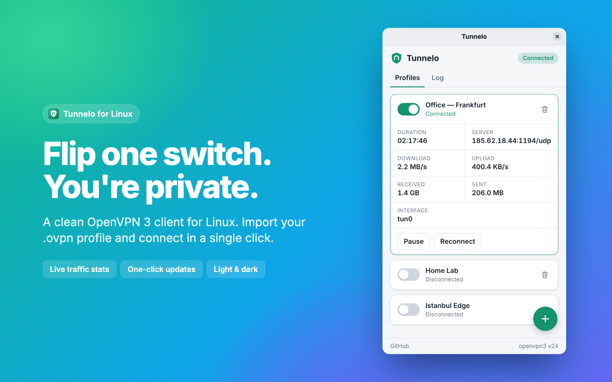

<p align="center">
  
</p>

<h1 align="center">Linux Client for OpenVPN</h1>

<p align="center">
  <strong>Flip one switch. You're private.</strong><br>
  A desktop client for OpenVPN 3 on Linux: import a profile, connect in one click.
</p>

<p align="center">
  <a href="https://github.com/aftandilmmd/openvpn-linux-client/releases/latest"><strong>Download</strong></a> · Ubuntu · Debian · Fedora · any distro (AppImage)
</p>

<p align="center">
  
</p>

## Features

- **One-click connect** — import an `.ovpn` file (button or drag and drop), then flip the switch.
- **Sign-in built in** — username and password, one-time codes and challenges, and web (SAML/SSO) sign-in that opens in your browser.
- **Live status** — connection time, server, download and upload speed, total traffic and interface.
- **Pause, resume, reconnect** and a live log you can copy.
- **Automatic updates** — when a new version is out, a banner appears in the app. One click downloads, verifies and installs it.
- **Light and dark mode**, following your desktop.

<p align="center">
  
</p>

It uses **openvpn3-linux**, OpenVPN's own Linux client, and talks to its services directly. Tunnels run in those services, not in the window: closing or updating the app keeps you connected, and connecting doesn't need an admin password.

## Installing

Download the file for your system from the [latest release](https://github.com/aftandilmmd/openvpn-linux-client/releases/latest):

- **Ubuntu / Debian:** the `.deb` (`amd64`, or `arm64` on ARM). Open it with your software center, or run `sudo apt install ./Linux*_amd64.deb`.
- **Fedora:** the `.rpm`, or `sudo dnf install ./Linux*.x86_64.rpm`.
- **Any distribution:** the `.AppImage`. Run `chmod +x Linux*.AppImage`, then start it.

On first start the app checks for OpenVPN 3, the official engine it runs on. If it's missing, click **Install OpenVPN 3** and enter your password: the app adds OpenVPN's official repository and installs it for you (Ubuntu, Debian and their derivatives, and Fedora). On other distributions, install the `openvpn3` package by following [OpenVPN's guide](https://community.openvpn.net/openvpn/wiki/OpenVPN3Linux).

Then click **+** and choose your `.ovpn` file. Profiles you already imported with the `openvpn3` command line show up automatically.

## Updates

The app checks GitHub for new releases on startup and every few hours. Updates are signed, and the app refuses any file that doesn't match its key. The AppImage updates itself. For the `.deb` and `.rpm` packages your system asks for your password once, because they are installed system-wide.

## FAQ

**Is this an official OpenVPN app?**
No. It's an independent app built on OpenVPN's official open-source Linux client, openvpn3-linux.

**My profile refers to separate `ca.crt` / `client.key` files.**
That's fine. Keep them next to the `.ovpn` file when importing and the app embeds them into the profile.

**Why does it need OpenVPN 3 at all?**
OpenVPN 3 runs the tunnels in the background with the right permissions, so connecting never asks for a password and closing the app keeps you connected. It isn't in most distributions' default repositories, which is why the app installs it from OpenVPN's own repository instead of the package pulling it in.

## Building from source

Requirements: Rust, Node.js 20, and the Tauri Linux dependencies (`libwebkit2gtk-4.1-dev libayatana-appindicator3-dev librsvg2-dev libxdo-dev`).

```sh
npm ci
npx tauri dev                     # run
npx tauri build                   # .deb, .rpm and .AppImage in src-tauri/target/release/bundle
```

From macOS or Windows, `docker/Dockerfile` provides the same build environment. `scripts/e2e/` holds an end-to-end test that imports a profile, signs in, connects to a local OpenVPN server and disconnects. CI runs it on every push.

Publishing a GitHub release builds both architectures and attaches the packages and the `latest.json` update manifest. Release builds need the `TAURI_SIGNING_PRIVATE_KEY` and `TAURI_SIGNING_PRIVATE_KEY_PASSWORD` repository secrets.

---

<sub>This project is not affiliated with OpenVPN Inc. OpenVPN is a registered trademark of OpenVPN Inc.</sub>
